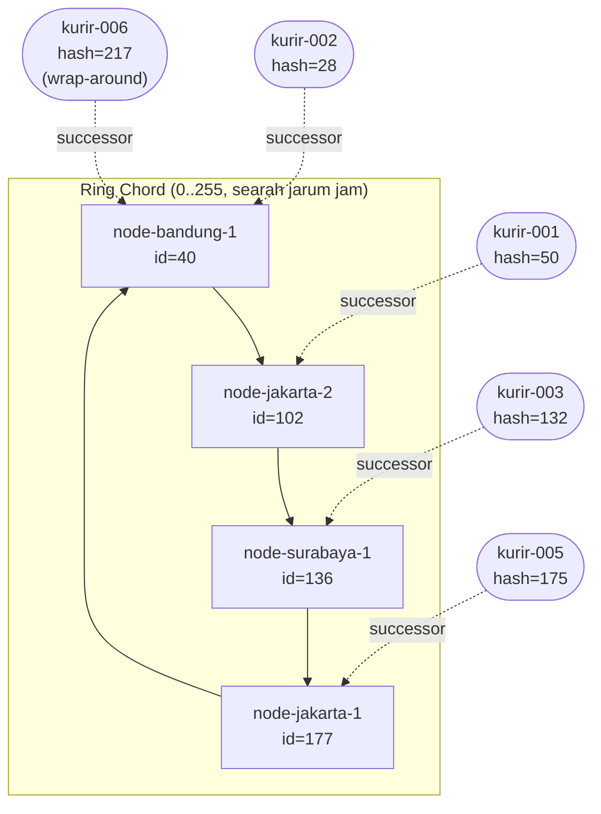

# Tugas 6 (Pekan 6) — Penamaan & Resolusi Lokasi

**Materi terkait:** Flat Naming, Structured Naming (DNS), Distributed Hash Table (DHT)/Chord.

## Studi Kasus

Pelanggan FoodGo kesulitan menemukan alamat IP server kurir yang **dinamis** (kurir berpindah lokasi/jaringan, IP-nya sering berubah). FoodGo butuh cara memetakan **ID Kurir** (identitas tetap) ke **alamat IP terkininya** tanpa server pusat tunggal yang jadi bottleneck/single point of failure.

## Implementasi

Simulasi Chord DHT single-process ada di `src/chord_simulation.py` (ruang identifier `m=8`, yaitu 0–255, hash SHA-1 mod 256).

```bash
python3 src/chord_simulation.py
```

Output lengkap satu kali jalan tersimpan di `bukti/output_simulasi.txt`.

### Bukti

| File di `bukti/` | Isi |
|---|---|
| `output_simulasi.txt` | Log lengkap seluruh skenario |
| `screenshot-1-join-leave.png` | Terminal saat program dijalankan: 4 node bergabung, registrasi kurir, lookup, join `node-medan-1` dan `node-semarang-1`, leave `node-jakarta-1` dan `node-semarang-1` |
| `screenshot-2-ganti-ip.png` | Bagian akhir output: kurir ganti IP dan lookup kurir tidak dikenal |

Ringkasan fungsi:

| Fungsi | Perilaku |
|---|---|
| `find_successor(k)` | Urutkan node, ambil node terkecil dengan id ≥ k. Jika tidak ada, **wrap-around** ke node dengan id terkecil. |
| `register_kurir()` | Hash ID kurir, cari successor, simpan mapping di sana. Dipanggil ulang dengan IP baru = memperbarui IP kurir. |
| `lookup()` | Hash ID kurir, cari successor, kembalikan IP (atau `None` bila tidak ada). |
| `join()` | Successor lama dicari **sebelum** node dimasukkan; key yang successor-nya kini node baru dipindahkan dari successor lama. |
| `leave()` | Node dihapus; tiap key yang dipegangnya dipindah ke successor baru di ring yang tersisa. |

Selain `self.data` dari skeleton, saya menambah `self.holder` (key → node pemegang saat ini) agar perpindahan tanggung jawab saat join/leave benar-benar tercatat dan bisa dicek, bukan hanya dihitung ulang saat lookup.

## Posisi di Ring

Hasil hash (`m=8`):

| Node | Hash (id) | IP |
|---|---|---|
| node-bandung-1 | 40 | 10.0.0.3 |
| node-jakarta-2 | 102 | 10.0.0.2 |
| node-surabaya-1 | 136 | 10.0.0.4 |
| node-jakarta-1 | 177 | 10.0.0.1 |

| Kurir | Hash (key) | Successor (penanggung jawab) |
|---|---|---|
| kurir-002 | 28 | node-bandung-1 (40) |
| kurir-001 | 50 | node-jakarta-2 (102) |
| kurir-003 | 132 | node-surabaya-1 (136) |
| kurir-005 | 175 | node-jakarta-1 (177) |
| kurir-006 | 217 | node-bandung-1 (40) — **wrap-around** |



## Analisis

### 1. Kenapa DHT/Chord, bukan flat naming sederhana atau DNS?

Masalah inti kasus ini: **ID kurir tetap, tetapi IP-nya berubah terus**, dan pelanggan harus selalu menemukan IP terkini tanpa ada satu komponen yang jika mati membuat semuanya mati.

**Tabel pusat ID→IP (flat naming sederhana).** Setiap perubahan IP kurir menulis ke satu server, dan setiap pelanggan membaca dari server yang sama. Karena IP kurir sering berubah, beban tulis terus-menerus menumpuk di satu titik (bottleneck). Jika server itu mati, tidak ada pelanggan yang bisa menemukan kurir mana pun (single point of failure), padahal kurirnya sendiri masih hidup. Di Chord, mapping tersebar: kurir-001 hanya ditangani node-jakarta-2, kurir-002 oleh node-bandung-1, dan seterusnya, sehingga beban baca/tulis terbagi ke banyak node dan matinya satu node hanya memengaruhi key yang dipegangnya (lihat bagian 3).

**DNS konvensional (structured naming).** DNS cocok untuk nama yang jarang berubah dan berstruktur hierarki, dengan cache berdasarkan TTL. Untuk kurir, ada tiga masalah: (a) perubahan IP harus diteruskan ke server otoritatif zona terkait, dan selama TTL belum habis resolver mengembalikan IP lama yang sudah salah; menurunkan TTL sangat kecil memindahkan beban ke server otoritatif; (b) ID kurir tidak punya struktur hierarki alami (`kurir-001` tidak "berada di bawah" domain mana pun), jadi keunggulan pembagian zona DNS tidak terpakai; (c) server otoritatif untuk zona tersebut tetap titik terpusat yang harus dioperasikan dan dijaga FoodGo.

**Chord.** Identitas kurir (ID) di-hash ke ruang yang sama dengan node, sehingga lokasi penyimpanan ditentukan oleh rumus (`successor(hash(ID))`), bukan oleh tabel yang harus dipelihara di satu tempat. Siapa pun bisa menghitung node penanggung jawab, dan pembaruan IP cukup menimpa satu entri di node tersebut (terbukti di simulasi: `kurir-001` ganti ke `172.16.5.77`, lookup langsung mengembalikan IP baru). Node yang bergabung atau keluar hanya memindahkan key di sekitarnya, tidak mengacak ulang semuanya (consistent hashing).

**Catatan jujur:** simulasi ini tidak memakai replikasi. Jika node mati mendadak (bukan `leave` yang rapi), mapping di node itu hilang sampai kurir mendaftar ulang. Chord asli menambahkan successor list dan replikasi untuk ini; di sini tidak diimplementasikan. Selain itu, lookup di simulasi dihitung langsung dari daftar seluruh node (O(n log n) karena diurutkan); Chord asli memakai finger table agar lookup O(log n) tanpa node mengetahui seluruh ring.

### 2. Penelusuran manual `lookup("kurir-001")`

Data awal: node-node di ring (setelah `join` pertama) memiliki id **40, 102, 136, 177**.

1. `hash_id("kurir-001")`: SHA-1 dari string `kurir-001`, diambil sebagai bilangan besar lalu `mod 256` → **50** (nilai ini dicetak program: `hash=50`).
2. `find_successor(50)` mengurutkan id node: `[40, 102, 136, 177]`.
3. Periksa berurutan, cari id terkecil yang ≥ 50:
   - 40 ≥ 50? Tidak.
   - 102 ≥ 50? **Ya** → berhenti. Successor = **102** = node-jakarta-2 (10.0.0.2).
4. `lookup` membaca `self.data[50]` = `("kurir-001", "192.168.1.10")` dan memastikan `self.holder[50] == 102`. Hasil: **192.168.1.10**.

Contoh yang memakai wrap-around: `lookup("kurir-006")`, hash = 217. Cek 40, 102, 136, 177: tidak ada yang ≥ 217, sehingga ring "melingkar" kembali ke id terkecil, **40** (node-bandung-1). Kasus inilah yang terlewat bila successor hanya dihitung dengan perbandingan tanpa wrap-around.

### 3. Apa yang terjadi pada mapping saat node keluar?

Dua skenario di `bukti/output_simulasi.txt`.

**a. `node-jakarta-1` (id=177) keluar.** Sebelumnya node ini memegang `kurir-005` (hash=175). Setelah dihapus, id tersisa `[40, 77, 102, 123, 136]`; tidak ada yang ≥ 175, sehingga wrap-around ke 40. Log program:

```
[LEAVE] Node 'node-jakarta-1' (id=177) keluar dari ring
    kurir-005 (hash=175, ip=192.168.1.14): node-jakarta-1(id=177, 10.0.0.1) -> node-bandung-1(id=40, 10.0.0.3)  [node keluar]
```

Kurir lain tidak terpengaruh: `kurir-001` tetap di node-semarang-1 dan `kurir-002` tetap di node-bandung-1.

**b. `node-semarang-1` (id=77) keluar.** Node ini memegang `kurir-001` (hash=50). Successor berikutnya setelah 77 adalah 102:

```
[LEAVE] Node 'node-semarang-1' (id=77) keluar dari ring
    kurir-001 (hash=50, ip=192.168.1.10): node-semarang-1(id=77, 10.0.0.6) -> node-jakarta-2(id=102, 10.0.0.2)  [node keluar]
```

Pola umum: **tanggung jawab node yang keluar jatuh ke successor-nya** (node berikutnya searah ring, dengan wrap-around bila perlu). IP kurir tidak berubah dan lookup tetap berhasil karena `find_successor` dihitung ulang pada ring yang baru. Sebaliknya, saat `join`, node baru mengambil key dari successor-nya: `node-semarang-1` (id=77) mengambil `kurir-001` dari node-jakarta-2, sedangkan `node-medan-1` (id=123) bergabung tanpa mengambil key karena tidak ada key di rentang (102, 123].

## Struktur Submission

```
tugas-06-penamaan-dht/
├── README.md      # Analisis + diagram ring
├── JURNAL.md
├── src/
│   └── chord_simulation.py
└── bukti/          # Output program (screenshot/log) untuk skenario join & leave
    ├── output_simulasi.txt
    ├── screenshot-1-join-leave.png
    └── screenshot-2-ganti-ip.png
```
